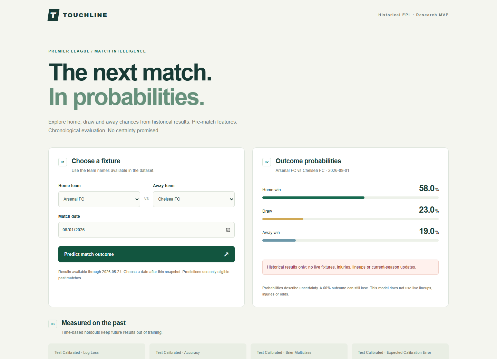
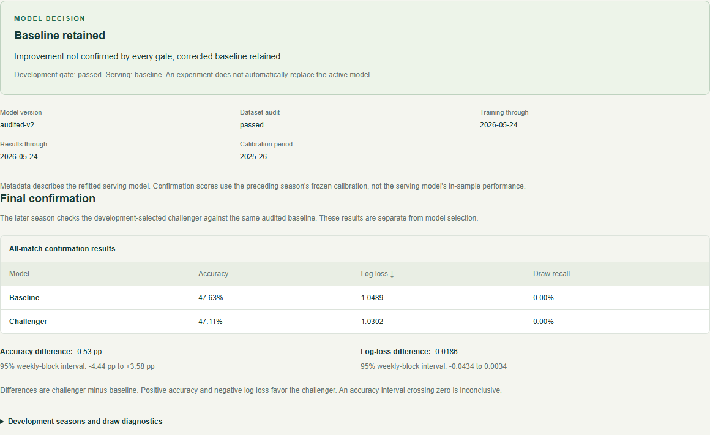
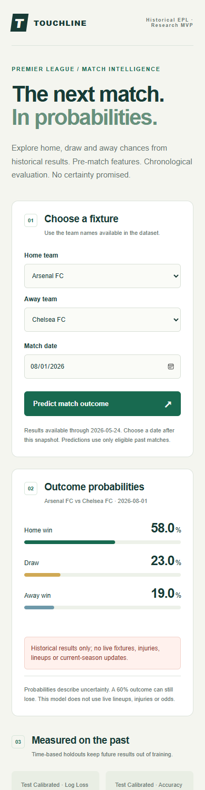
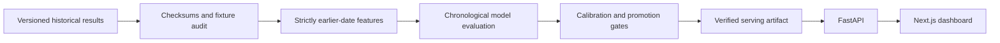

<div align="center">

# Touchline

### The next match. In probabilities.

An end-to-end Premier League prediction app with real historical data, auditable experiments, and a responsive dashboard.

[](https://github.com/sachiyacodes/epl-match-outcome-predictor/actions/workflows/ci.yml)
[](requirements-lock.txt)
[](frontend/package.json)
[](LICENSE)

[Quick start](#run-locally-windows) · [Results](#measured-results) · [Architecture](#how-it-works) · [Technical guide](docs/REPRODUCIBILITY.md)

</div>



*A real local API response for a hypothetical Arsenal–Chelsea fixture on August 1, 2026. The snapshot ends May 24, 2026; this is not a live fixture forecast.*

## What you can do

- **Explore a fixture.** Choose two clubs and a date; get home-win, draw, and away-win probabilities.
- **Inspect the evidence.** See confirmation scores, calibration metrics, model metadata, and the promotion decision.
- **Reproduce the pipeline.** Audit source bytes, rebuild the selected serving model, and run the API locally.
- **Trace the data.** Follow source revisions, checksums, fixture-level date corrections, and independent verification reports.

Built with **Next.js + TypeScript**, **FastAPI**, **scikit-learn**, **NumPy / SciPy**, and **GitHub Actions**. No paid API, account, or database is required for the local demo.

## Product tour

### Evaluation you can inspect



The dashboard keeps development and confirmation results separate. A challenger must pass the recorded promotion gates before replacing the baseline.

<details>
<summary><strong>Mobile preview</strong></summary>

<p align="center">
  
</p>

</details>

The three previews above come from the running app, captured November 15, 2026. Desktop: 1440 × 1040; mobile: 390 × 1500. [Earlier full dashboard view](docs/images/dashboard.png).

## Run locally (Windows)

Install **Git**, **Python 3.12**, and **Node.js 24 LTS**. Open PowerShell:

```powershell
git clone https://github.com/sachiyacodes/epl-match-outcome-predictor.git
cd epl-match-outcome-predictor
py -3.12 -m venv .venv
.\.venv\Scripts\python.exe -m pip install -r requirements-lock.txt
$env:PYTHONPATH = 'backend'
.\.venv\Scripts\python.exe -m epl.audit
.\.venv\Scripts\python.exe -m epl.restore_model
.\.venv\Scripts\python.exe -m uvicorn epl.api:app --host 127.0.0.1 --port 8000
```

In a second PowerShell terminal, from the repository root:

```powershell
cd frontend
npm ci
npm run dev
```

Open **[the dashboard](http://127.0.0.1:3000)** or **[interactive API docs](http://127.0.0.1:8000/docs)**. Both run on your machine; no public app deployment is configured. Stop either server with `Ctrl+C`.

The repository includes the audited dataset and sealed reports. `epl.audit` verifies cached source bytes; `epl.restore_model` rebuilds binary models after checking the frozen code, data, and protocol. It does not rerun the 69-configuration search. Environment activation and PowerShell policy changes are unnecessary. If `py` opens the Microsoft Store, use your installed Python 3.12 executable's full path.

## How it works



Features use only matches completed on earlier dates. Every fixture on the same date receives features before that day's results enter history. Evaluation refits coefficients monthly using earlier data; confirmation uses a configuration and calibration temperature fixed before that season's evaluation.

The active model is multinomial logistic regression. The bounded research grid also evaluates Elo/richer form features, shallow boosting, Poisson, and Dixon–Coles models. A separate historical shot-quality experiment stays outside serving. XGBoost is not included.

| Area | Where to look |
| --- | --- |
| Ingestion, features, models, API | [`backend/epl/`](backend/epl/) |
| Responsive dashboard | [`frontend/app/`](frontend/app/) |
| Source snapshot, audit, correction ledger | [`data/audited/`](data/audited/) |
| Frozen protocol and prediction ledgers | [`artifacts/research-v2/`](artifacts/research-v2/) |
| Windows/Linux backend and frontend checks | [`.github/workflows/ci.yml`](.github/workflows/ci.yml) |

## Measured results

**The audited baseline remains active.** The challenger improved development accuracy but failed the locked confirmation promotion criteria.

| 2025/26 confirmation · 380 matches | Baseline | Selected challenger |
| --- | ---: | ---: |
| Accuracy ↑ | **47.63%** | 47.11% |
| Calibrated log loss ↓ | 1.048861 | **1.030215** |
| Brier score ↓ | 0.631972 | **0.619025** |
| Draw recall ↑ | 0.00% | 0.00% |

The accuracy difference is **−0.53 percentage points**, with an approximate paired weekly-block 95% interval of **[−4.44, +3.58]**. Better log loss alone did not satisfy promotion. Zero draw recall is a clear weakness: both models assign draw probabilities but select no draws as their most likely outcome in this confirmation set.

Development accuracy was 53.01% for the baseline and 54.59% for the selected Poisson challenger across seven seasons. Those scores guided selection; they are not independent confirmation. The original 53.42% benchmark is superseded after correcting upstream fixture dates. [Full model report](MODEL_REPORT.md).

The separate shot-quality study improved accuracy from 43.85% to 45.38% on 130 historical fixtures: two extra correct predictions. It does not establish a persistent or modern-season improvement. [Research protocol and outputs](artifacts/shot-quality/README.md).

## Real data, explicit provenance

- **6,080 real EPL matches**, spanning 2010/11–2025/26, through **May 24, 2026**. OpenFootball snapshot URLs and SHA256 checksums are pinned.
- **66 incorrect upstream dates repaired** through fixture-level evidence. Raw source bytes remain unchanged; no generic year-shifting rule is used.
- **380 matches independently reconciled** with Wyscout metadata, with no date or score conflicts. The other **5,700** have structural validation, not independent confirmation.
- **No fabricated fallback.** Acquisition errors fail visibly. Synthetic fixtures appear only in tests.

The committed snapshot supports offline auditing. Acquisition commands fetch immutable sources and check their hashes; the optional Wyscout shot-quality experiment downloads about 77 MB. Current-season results, injuries, lineups, live odds, and current xG feeds are unavailable in this project. Derived historical xG is this project's estimate, not provider-supplied Wyscout xG.

Read [data sources, licenses, and exclusions](DATA_SOURCES.md), [independent verification](data/verification/README.md), or the [full acquisition and reproduction guide](docs/REPRODUCIBILITY.md).

## API example

Use club names from `GET /teams` and a date after the snapshot cutoff:

```powershell
$fixture = @{ home_team = 'Arsenal FC'; away_team = 'Chelsea FC'; match_date = '2026-08-01' } | ConvertTo-Json
Invoke-RestMethod http://127.0.0.1:8000/predict -Method Post -ContentType 'application/json' -Body $fixture
```

`POST /predict` returns `H`, `D`, and `A` probabilities plus the model version, training cutoff, calibration period, and audit status. `GET /metrics` exposes evaluation reports. Invalid fixtures return `422`; missing or invalid models return `503`. [API and configuration details](docs/REPRODUCIBILITY.md#api-and-checks).

## Checks

```powershell
$env:PYTHONPATH = 'backend'
.\.venv\Scripts\python.exe -m pytest -q
.\.venv\Scripts\python.exe -m pip check
cd frontend
npm test
npm run typecheck
npm run build
```

The published CI checks the backend on Windows and Linux, plus frontend tests, types, and production build. The implementation verification recorded **98 backend tests and 4 frontend tests passing**. See the [CI runs](https://github.com/sachiyacodes/epl-match-outcome-predictor/actions) and [verification record](VERIFICATION.md).

## Scope and next steps

This is a research MVP and portfolio project. Predictions describe hypothetical fixtures using historical results, not current schedules or squads. No accuracy or betting-profit guarantee is made. Public hosting, authentication, and scheduled data refresh are not configured.

Future work should start with broader independently verified, appropriately licensed data and a genuinely later evaluation period. The inspected confirmation season cannot become an untouched test again.

## License

Code: [MIT](LICENSE). OpenFootball data: CC0. Wyscout research data: CC BY 4.0, with attribution and transformations documented in [DATA_SOURCES.md](DATA_SOURCES.md). Software licensing does not replace data licensing. This project is not affiliated with the Premier League or its data providers.
