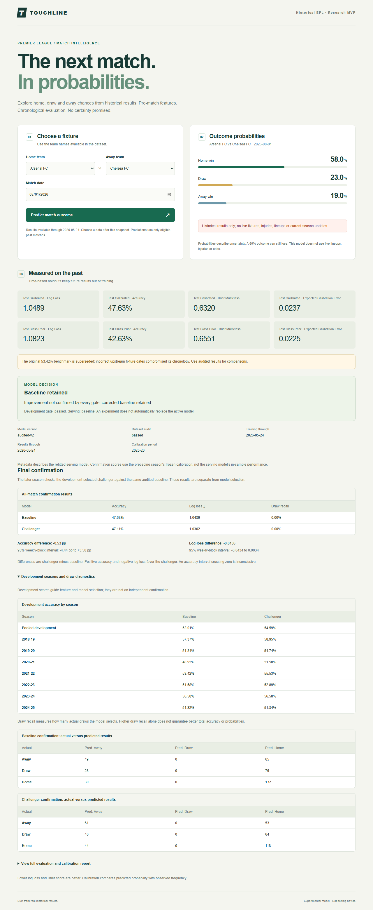

# Reproducibility and technical guide

[](https://github.com/sachiyacodes/epl-match-outcome-predictor/actions/workflows/ci.yml)

Predict home-win, draw and away-win probabilities with an audited historical dataset, leakage-aware features, FastAPI and a Next.js TypeScript dashboard. This is a reproducible research project with honest negative results, not a claim of production forecasting accuracy.

- **6,080 historical EPL matches**, with 66 source-date corrections backed by fixture evidence.
- **380/6,080 matches independently reconciled** against Wyscout: no date or score conflicts. Other matches have structural checks, not independent confirmation.
- **69 model configurations** with chronological monthly refits and a locked confirmation season.
- A separate **shot-quality experiment** using openly licensed Wyscout events, kept out of the serving model.
- Windows setup, reproducible reports, pinned dependencies and CI on Windows/Linux.

## Results without inflated claims

| Experiment | Baseline accuracy | Challenger accuracy | Interpretation |
| --- | ---: | ---: | --- |
| 2025/26 confirmation, 380 matches | 47.63% | 47.11% | Challenger failed promotion; audited baseline remains active |
| Exploratory 2017/18 shot-quality comparison, 130 matches | 43.85% | 45.38% | Two additional correct predictions; too small and historical to establish a modern improvement |

These are different datasets and evaluation procedures. The shot-quality experiment does not replace the main model. Full results: [model comparison](../MODEL_REPORT.md), [shot-quality report](../artifacts/shot-quality/report.json), [source verification](../data/verification/README.md), [data rights and attribution](../DATA_SOURCES.md).

<details>
<summary>View dashboard screenshot</summary>



</details>

**The original 53.42% benchmark is superseded.** Its source dated 66 July 2020 fixtures in July 2019. The audited pipeline preserves raw bytes and applies source-verified corrections. Reproducing the original procedure after correction scores 53.29%. Neither historical score is the new confirmation result.

## Windows setup

Install Python 3.12 and Node.js 24 LTS. In PowerShell, from this repository root:

```powershell
git clone https://github.com/sachiyacodes/epl-match-outcome-predictor.git
cd epl-match-outcome-predictor
py -3.12 -m venv .venv
.\.venv\Scripts\python.exe -m pip install -r requirements-lock.txt
$env:PYTHONPATH = 'backend'
.\.venv\Scripts\python.exe -m epl.audit
.\.venv\Scripts\python.exe -m epl.restore_model
.\.venv\Scripts\python.exe -m pytest -q
.\.venv\Scripts\python.exe -m uvicorn epl.api:app --host 127.0.0.1 --port 8000
```

The repository includes audited source files and sealed reports, but no binary model or credentials. `restore_model` validates the code/data/protocol and rebuilds serving models from the sealed decision without rerunning model selection or confirmation. The audit command verifies cached bytes. No accounts, paid APIs or database are needed for local use.

To reproduce the full, longer experiment grid instead:

```powershell
.\.venv\Scripts\python.exe -m epl.experiments --stage develop
.\.venv\Scripts\python.exe -m epl.experiments
```

Development runs the fixed comparison grid. The next command reuses the sealed confirmation if present. It does not create another untouched test. Results are cached locally.

If `py` opens the Microsoft Store, invoke your installed Python 3.12 executable by its full path. Environment activation is unnecessary; PowerShell execution policy need not change.

In a second terminal:

```powershell
cd frontend
npm ci
npm run dev
```

Open http://127.0.0.1:3000; API documentation: http://127.0.0.1:8000/docs. Stop with Ctrl+C. For a frontend production build, run `npm run build`, then `npm start`.

## Real data and corrections

[OpenFootball](https://github.com/openfootball/football.json) publishes the results under CC0-1.0. The snapshot contains **6,080 real matches**, 2010/11–2025/26, through **2026-05-24**. Synthetic matches exist only in tests.

- JSON revision: `e6744429ee395bc86f247348c6184bb08d4eb361`.
- Correction evidence: [immutable 2019/20 text](https://github.com/openfootball/eng-england/blob/9ee7a0c351805c99cc334478a9bf04b7d0432fec/2019-20/1-premierleague.txt).
- Independent corroboration: [official Arsenal–Norwich report, July 1, 2020](https://www.premierleague.com/en/news/1697162).
- `data/audited/manifest.json`: immutable URLs and SHA256 checksums.
- `corrections.json`: 66 exact fixture/date overrides, source scores, evidence lines and checksums. There is no generic year-shifting rule.
- `audit.json`: season checks, correction counts and quarantine status.

Every complete season must have 380 unique fixtures, 20 clubs, 19 home and 19 away appearances per club, plausible dates and no same-day double appearances. Both `score.ft: [h,a]` and `score: [h,a]` are supported. Missing scores are unfinished fixtures; `[0,0]` is a real draw. Unreconciled 2019/20 data is quarantined as a whole.

The loader re-verifies raw files, correction evidence, ledger and audit gates. Download errors stop acquisition; no fabricated fallback exists. Structural auditing cannot prove every remaining upstream result correct.

Original `data/raw/`, `artifacts/model.joblib` and `artifacts/metrics.json` remain unchanged in the original development workspace. Binary models, old downloads and local output archives are excluded from Git. Legacy training remains available for reproduction, but it does not repair chronology: use the audited workflow for new work.

## Independent verification and shot-quality research

```powershell
.\.venv\Scripts\python.exe -m epl.verify_sources
.\.venv\Scripts\python.exe -m epl.verify_sources --offline
.\.venv\Scripts\python.exe -m epl.shot_quality
```

Source verification downloads less than 1 MB of original Wyscout match/team metadata and compares 2017/18 fixture identities, dates and full-time scores. The second command requires those cached bytes. Conflicts produce a failing exit status and are never silently repaired. Other seasons remain explicitly unverified by an independent provider.

Shot-quality research downloads a roughly 77 MB original event archive once, verifies its checksum and fits a fixed chronological shot model. Features are shot distance, angle and body-part context; goal tags are labels only. Penalties are excluded. Out-of-time estimated xG is aggregated and used only from earlier completed matches. It is our estimate, not provider-supplied Wyscout xG.

The fixed 130-match outcome comparison covers February–May 2018. It is a small exploratory study, not evidence of contemporary EPL performance. No hyperparameter search or serving-model promotion occurs. Original downloads stay in ignored `data/external/`; reproducible aggregate reports and attributed derived research data are included.

No current-season feed, injuries, lineups, xG, odds or possession data are acquired. Observed 2026/27 source coverage was incomplete and stale. Football-Data.co.uk is not scraped because its [usage statement](https://football-data.co.uk/data.php) restricts automated training uses.

## Features and models

Features use only dates strictly before a fixture. All matches on a date receive features before any same-day outcome enters history. Older evaluation results may update later features. Coefficients refit at each evaluated month's first calendar day, using only earlier dates.

| Model | Bounded experiment |
| --- | --- |
| Corrected logistic baseline | Previous-ten form/rest features; monthly refits |
| Elo logistic regression | Baseline-plus-Elo or rich form/venue features; 54 configurations |
| Shallow gradient boosting | Best logistic feature settings; 8 configurations; no random early stopping |
| Poisson and Dixon–Coles | Five-season training window; decay and low-score correction ablations; 6 configurations |

Elo starts at 1500, regresses 25% toward 1500 each offseason and tests `K={10,20,40}` with home offsets `{0,50,100}`. Rich features include last 5/10/20 form, venue form shrunk using five prior-equivalent matches, opponent strength and history freshness. Short-term form resets after gaps exceeding 365 days. Aliases join old and modern club names. Fixed cold-start priors are feature defaults, not invented observations.

Score models fit centered attack/defence, scoring intercept and home advantage. Dixon–Coles keeps low-score probabilities positive. Optimization failure disqualifies a configuration; unseen teams receive league-average strength. Score grids omit less than `1e-8` probability. Existing NumPy, SciPy and scikit-learn suffice. XGBoost, neural networks and ensembles are outside this round.

## Evaluation and promotion

- **Development:** seven seasons, 2018/19–2024/25. These scores guide selection and are optimistic estimates.
- **Confirmation:** 2025/26, 380 later matches, with monthly refits. Earlier confirmation results may enter subsequent training; configuration and evaluation temperature remain fixed for the season.
- **Development gate:** at least +1 percentage point accuracy, raw log loss no more than +0.01 worse, and non-worse accuracy in a majority of seasons.
- **Selection:** highest eligible accuracy, then lower log loss, then simpler model. No qualifying challenger means retain the corrected baseline.
- **Calibration:** previous-season monthly out-of-time probabilities; one temperature in `[0.25,4]`, at least 300 predictions and all classes. Failed fitting or worse calibration-fit loss uses `T=1`. Temperature cannot change top-class accuracy.
- **Promotion:** positive confirmation accuracy gain, a paired 95% accuracy interval entirely above zero, and calibrated log loss no more than +0.01 worse. Otherwise the corrected baseline remains active.

Uncertainty uses 2,000 paired calendar-week bootstrap resamples. Intervals are approximate; dependence can extend beyond a week. There is no confidence filtering, forced draw threshold or class reweighting.

After confirmation, serving models refit on all audited results. Their serving temperature uses the completed confirmation season's out-of-time predictions for subsequent-season use. Displayed confirmation scores retain the earlier frozen temperature; they are not in-sample scores of that final refit.

Reports include accuracy, log loss, Brier score, ECE, reliability curves, confusion matrices, class precision/recall, macro-F1, season results and promoted-team breakdowns. No accuracy level or profitability is guaranteed.

## Reproducibility and rollback

`artifacts/research-v2/protocol.json` records code/data hashes, grid, seed and gates before confirmation. `selection.json` freezes the development decision. Prediction CSVs retain fixture identity, fit cutoff and raw probabilities. `confirmation.json` seals selection and ledger hashes. Changed ledgers or code cannot silently reuse the locked result.

Changing code or data requires another experiment directory under `artifacts` using `--output`. It does not make an already-inspected confirmation season untouched again. Do not tune against confirmation and claim a fresh result.

`artifacts/active.json` selects a checksum-verified artifact. A failed challenger selects the audited, refitted baseline; the original artifact is never overwritten. Invalid pointers/checksums fail closed. Restart the API after switching because artifacts are cached. Do not silently restore the defective legacy benchmark as the safe fallback.

Load only locally generated joblib artifacts: untrusted files can execute code. No public deployment, authentication or live-results scheduling is configured.

## API and checks

- `GET /health`: server and artifact-presence status.
- `GET /teams`: latest snapshot season's clubs and data cutoff.
- `GET /metrics`: evaluation, audit and model metadata.
- `POST /predict`: existing request and `A/D/H` probabilities, plus model version, training/calibration period and audit status.

```powershell
$fixture = @{ home_team = 'Arsenal FC'; away_team = 'Chelsea FC'; match_date = '2026-08-01' } | ConvertTo-Json
Invoke-RestMethod http://127.0.0.1:8000/predict -Method Post -ContentType 'application/json' -Body $fixture
```

Use exact names from `/teams` and a date after `data_through`. Invalid dates, identical or unknown clubs return 422. Missing/invalid artifacts return 503. Predictions represent hypothetical fixtures using a historical snapshot, not current schedules or squads.

Localhost dashboard origins are allowed. Set `NEXT_PUBLIC_API_URL` in `frontend/.env.local` for another target; remote origins also need backend CORS changes. No secrets belong in that public setting.

```powershell
.\.venv\Scripts\python.exe -m pytest -q
.\.venv\Scripts\python.exe -m compileall -q backend
.\.venv\Scripts\python.exe -m pip check
cd frontend
npm test
npm run typecheck
npm run build
```

See `MODEL_REPORT.md` and `VERIFICATION.md` for measured results and executed checks. Dependencies remain pinned. One upstream Starlette/httpx test-client deprecation warning remains.

## License

Project source code is [MIT licensed](../LICENSE). Third-party data retains its original license: OpenFootball uses CC0; Wyscout research data uses CC BY 4.0. Those data licenses are not replaced by the software license. See [DATA_SOURCES.md](../DATA_SOURCES.md) for attribution, changes, coverage and exclusions. This project is not affiliated with the Premier League or its data providers.
